<!-- Shihan QIU · profile README -->

<div align="center">

<picture>
  <source media="(prefers-color-scheme: dark)" srcset="assets/hero-dark.svg">
  <source media="(prefers-color-scheme: light)" srcset="assets/hero-light.svg">
  
</picture>

<br>

<picture>
  <source media="(prefers-color-scheme: dark)" srcset="https://readme-typing-svg.demolab.com?font=Fira+Code&weight=600&size=26&duration=2600&pause=900&color=A78BFA&center=true&vCenter=true&width=760&height=62&lines=trying+my+best;building+small+things%2C+properly;currently%3A+RoboEmail">
  
</picture>

<br>

<br>

<a href="mailto:19558222390@163.com"></a>
<a href="https://rbem.online"></a>


</div>

---

> **I build small, careful things — mostly for people who have to write in a language that isn't theirs.**

## About

```ts
const shihan = {
  studying: "University of Nottingham Ningbo China",
  based:    "Ningbo, China",
  focus:    ["TypeScript", "Python", "C → STM32"],
  building: "RoboEmail",
  motto:    "trying my best",
};
```

- 🎓 Coursework in **Python** and **C**, with an eye on embedded systems.
- ✍️ Drawn to the gap between what people *mean* and what they *can say* — that gap is where [RoboEmail](https://github.com/Sherry-Qiuu/RoboEmail) and [novel-style-polish](https://github.com/Sherry-Qiuu/novel-style-polish) came from.
- 🎨 I care how software *feels*, not just what it does — [edge-fluent-appearance](https://github.com/Sherry-Qiuu/edge-fluent-appearance) exists because a page can look like it belongs to the browser.
- 🌱 Trying to make fewer things, better.

## Toolbox

<picture>
  <source media="(prefers-color-scheme: dark)" srcset="https://skillicons.dev/icons?i=ts,js,py,c,css,html,node,react,git,github,linux,vscode&theme=dark&perline=12">
  
</picture>

## Selected work

| Project | What it is |
| :-- | :-- |
| **[RoboEmail](https://github.com/Sherry-Qiuu/RoboEmail)**<br>`TypeScript` · `React 19` · `Hono`<br>[live ↗](https://rbem.online) | Academic email, written properly. Pick a recipient, a formality, a purpose — get British academic English back, with the Chinese reasoning beside every line. Not a translator; a co-writer for the 576 people you might need to address. |
| **[edge-fluent-appearance](https://github.com/Sherry-Qiuu/edge-fluent-appearance)**<br>`CSS` · `Design system` | An Edge-inspired Fluent appearance layer for any page: 3 modes, 5 color themes, 5 image themes, one script. |
| **[web-minesweeper](https://github.com/Sherry-Qiuu/web-minesweeper)**<br>`JavaScript` · `Canvas`<br>[play ↗](https://minesweeper-arena-34333.app.workbuddy.host/) | 扫雷竞速 — minesweeper at speed, where the timer is the whole point. |
| **[c-learn](https://github.com/Sherry-Qiuu/c-learn)**<br>`C` | A fast C ramp-up for people arriving from C++: 12 assert-checked exercises and 2 multi-file projects, aimed at STM32. |

<sub>Also around: [novel-style-polish](https://github.com/Sherry-Qiuu/novel-style-polish) · [Flow](https://github.com/Sherry-Qiuu/Flow) · [match-3-game](https://github.com/Sherry-Qiuu/match-3-game) · [Halloween-Plan](https://github.com/Sherry-Qiuu/Halloween-Plan)</sub>

## Numbers

<div align="center">

<a href="https://github.com/Sherry-Qiuu"></a>

<br>


</div>

## Now

- 🔭 Shipping **RoboEmail** — the fixes nobody notices are the ones that matter.
- 📚 Learning C properly, one `assert` at a time.
- 🧪 Believing that a tool should be easy to delete — if it can't be, it's a dependency, not a tool.
- 💬 Ask me about TypeScript, Fluent design, or why a paragraph sounds wrong.

---

<div align="center">

<sub><i>trying my best</i> — Ningbo, China</sub>

</div>
